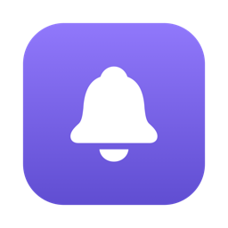
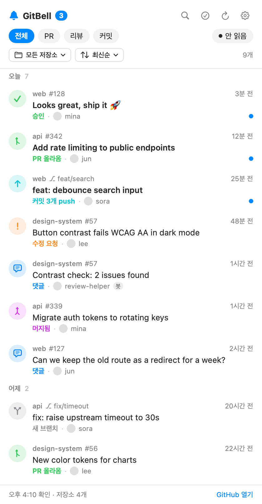

<div align="center">



# GitBell

_GitHub 활동을 Mac 메뉴 막대에서 바로 봅니다._

[](#필요한-것)
[](Package.swift)
[](LICENSE)

[설치](#설치) · [기능](#기능) · [동작 방식](#동작-방식) · [자주 묻는 질문](#자주-묻는-질문) · [English](README.md)



</div>

내가 접근할 수 있는 모든 저장소의 **PR, 리뷰, 댓글, 머지, 커밋**을 메뉴 막대에서 확인합니다. Slack 봇도, 웹후크도, 저장소 설정도 필요 없습니다.

## 설치

```bash
npx gitbell
```

이 명령 하나로 끝납니다. 설치기가 내 Mac에서 GitBell을 빌드해 `~/Applications`에 넣고 실행합니다. 메뉴 막대에 종 아이콘이 생깁니다.

> [!NOTE]
> 내 Mac에서 직접 빌드하기 때문에 "확인되지 않은 개발자" 경고 없이 열립니다. 첫 빌드는 1분쯤 걸리고 Xcode 명령줄 도구(`xcode-select --install`)가 있어야 합니다.

**GitHub 연결.** [GitHub CLI](https://cli.github.com)를 쓰고 있다면 따로 할 일이 없습니다. `gh` 로그인을 그대로 씁니다. 쓰지 않는다면 `repo`, `notifications`, `read:org` 권한을 준 [개인 액세스 토큰](https://github.com/settings/tokens/new?scopes=repo,notifications,read:org&description=GitBell)을 앱에 붙여넣으세요.

## 기능

- **한 목록에 모두.** PR 올라옴·머지·닫힘, 승인, 수정 요청, 댓글, push, 새 브랜치를 저장소 구분 없이 시간순으로 보여 줍니다.
- **macOS 알림.** 알림을 누르면 해당 PR이나 커밋 페이지가 열립니다.
- **필터.** 전체, PR, 리뷰, 커밋으로 나눠 봅니다. 안 읽은 항목에는 점이 찍히고 종 아이콘 옆에 개수가 뜹니다.
- **조용한 기본값.** 내 활동과 배포 봇의 push는 숨겨서 다른 사람이 한 일만 남습니다.
- **개인정보 보호.** GitHub API하고만 통신합니다. 토큰은 macOS 키체인에만 저장합니다.
- **한국어·영어.** macOS 언어 설정을 따릅니다.

## 동작 방식

GitBell은 2분마다 GitHub을 확인합니다. 간격은 1~15분 중 고를 수 있습니다. 저장소가 100개를 넘으면 매번 전부 읽을 때 API 한도에 걸립니다. 그래서 **움직인 저장소**만 골라 읽습니다.

| 고르는 기준 | 잡아내는 것 |
| --- | --- |
| 최근 3일 안에 push가 있었던 저장소 | 커밋, 새 PR, 머지 |
| GitHub 알림함에 새 소식이 온 저장소 | push가 뜸한 저장소의 댓글과 리뷰 |

한 번 확인할 때 API를 10~20회쯤 씁니다. GitHub 한도(시간당 5,000회)에 한참 못 미칩니다.

> [!TIP]
> 처음 실행하면 지난 24시간 활동을 모두 읽음으로 채웁니다. 오래된 알림이 한꺼번에 쏟아지지 않습니다.

## 지우기

```bash
npx gitbell uninstall           # 앱만 지우기
npx gitbell uninstall --purge   # 설정, 기록, 저장한 토큰까지 지우기
```

## 자주 묻는 질문

<details>
<summary><b>어떤 저장소가 안 보여요.</b></summary>

GitBell은 내가 소유하거나, 협업자로 들어가 있거나, 조직을 통해 접근하는 저장소를 읽습니다. 최근 push가 없는 저장소의 댓글은 GitHub에서 그 저장소를 Watch하고 있을 때만 보입니다. 저장소를 **Ignore**로 두면 GitHub이 알림을 보내지 않습니다.
</details>

<details>
<summary><b>알림 배너가 안 떠요.</b></summary>

**시스템 설정 → 알림 → GitBell**에서 **알림 허용**을 켜세요. GitBell의 **설정 → 알림 표시**가 켜져 있는지도 확인하세요.
</details>

<details>
<summary><b>직접 빌드할 수 있나요?</b></summary>

```bash
git clone https://github.com/kgyujin/gitbell && cd gitbell
swift test                 # 테스트 실행
scripts/build-app.sh       # dist/GitBell.app 생성
```

가상 데이터로 패널을 이미지로 그리려면 `dist/GitBell.app/Contents/MacOS/GitBell --snapshot out.png --demo [--dark]`를 실행합니다.
</details>

## 필요한 것

- macOS 13 Ventura 이상
- Xcode 명령줄 도구 (설치할 때 빌드용)
- Node.js 18 이상 (`npx`용)
