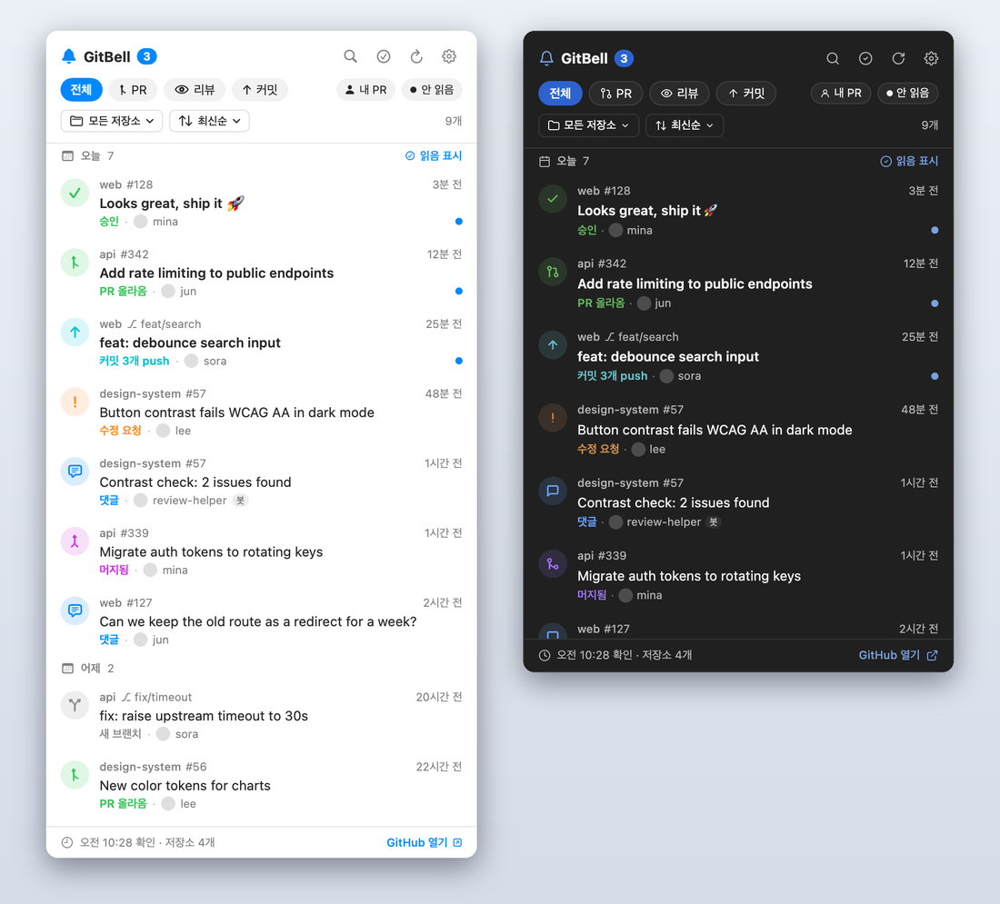
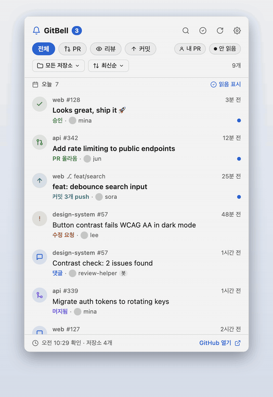
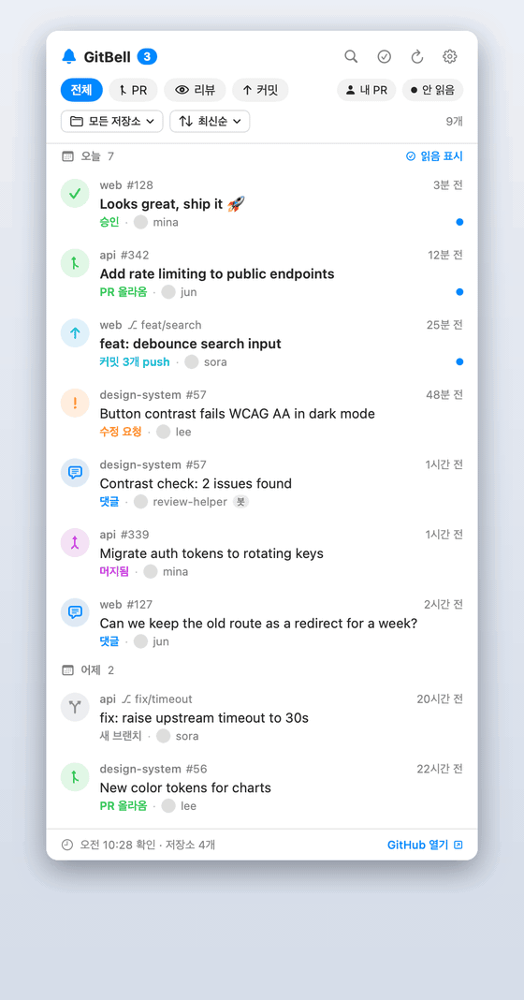
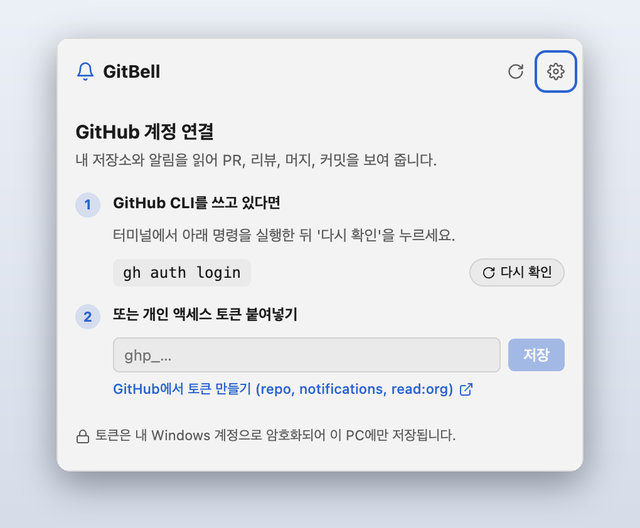
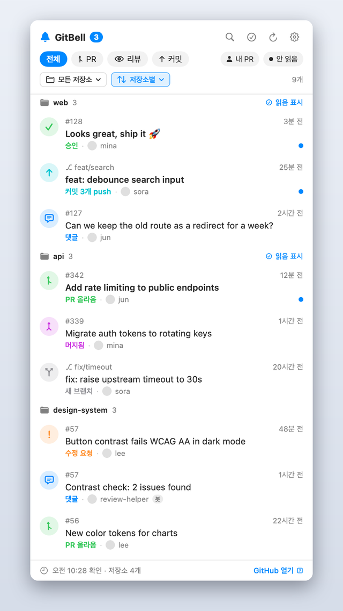
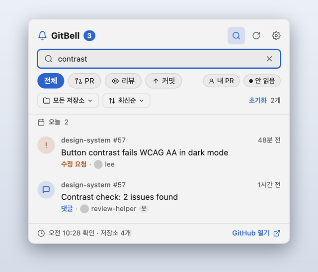
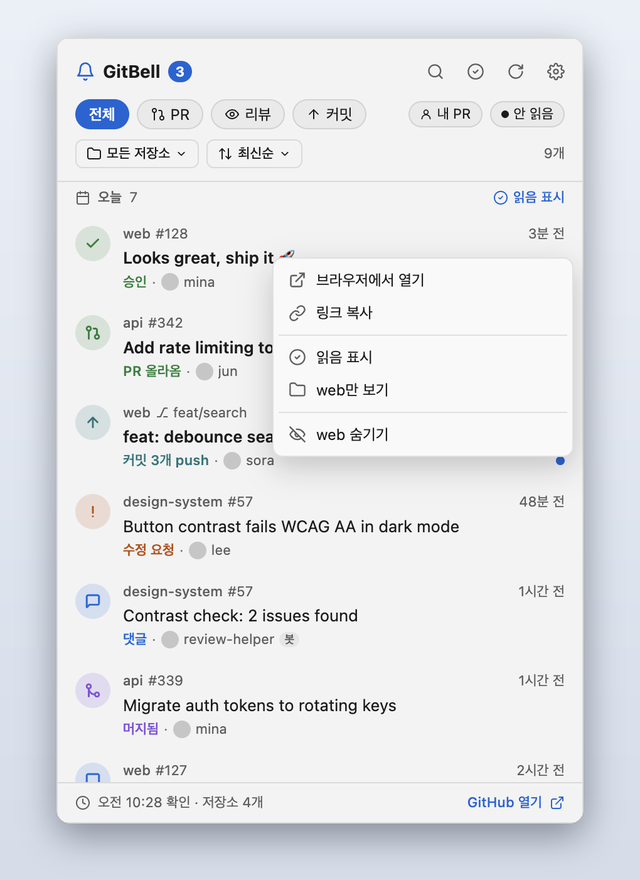
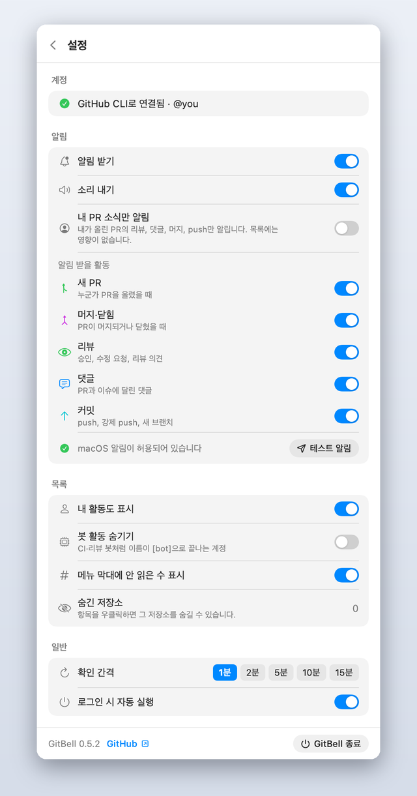
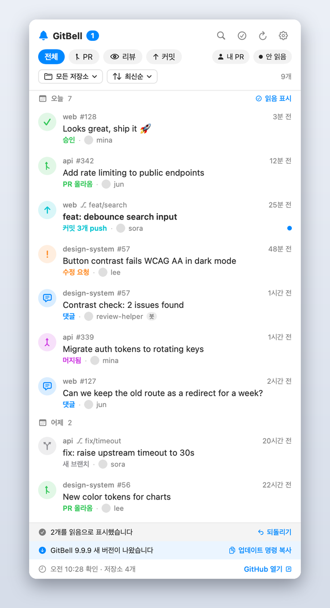
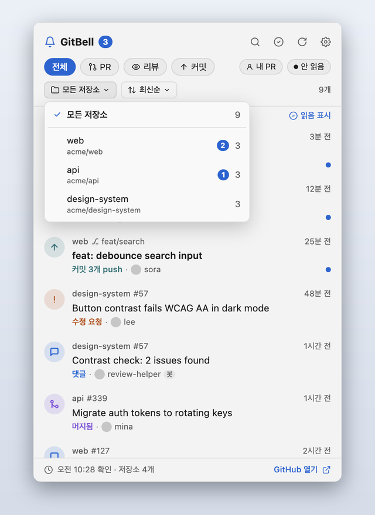

<div align="center">


# GitBell

_GitHub 활동을 Mac 메뉴 막대나 Windows·Linux 트레이에서 바로 봅니다._

[](https://github.com/kgyujin/gitbell/releases/latest)
[](#macos)
[](#windows)
[](#linux)
[](LICENSE)

[설치](#설치) · [기능](#기능) · [사용 팁](#사용-팁) · [GitHub을 확인하는 방법](#github을-확인하는-방법) · [자주 묻는 질문](#자주-묻는-질문) · [English](README.md)



</div>

내가 접근할 수 있는 모든 저장소의 **PR, 리뷰, 댓글, 머지, 커밋**을 한곳에서 보고, 새 활동이 생기면 알림으로 받습니다. 봇이나 웹후크 같은 저장소 설정은 필요 없습니다.

## 움직이는 모습

<table>
<tr>
<td align="center" width="50%"><b>Windows</b><br></td>
<td align="center" width="50%"><b>macOS</b><br></td>
</tr>
</table>

## 설치

[Releases](https://github.com/kgyujin/gitbell/releases/latest)에서 내 OS에 맞는 설치 파일을 받아 실행합니다. Node.js나 빌드 도구는 필요 없습니다.

| OS | 받을 파일 |
| --- | --- |
| macOS 13 이상 (Apple 실리콘·Intel) | `.dmg` |
| Windows 10 이상 | `.exe` |
| Linux | `.AppImage` 또는 `.deb` |

> [!IMPORTANT]
> 설치 파일에는 코드 서명이 없어서 처음 열 때 OS가 경고합니다. 아래처럼 한 번만 허용하면 다음부터는 그대로 열립니다.

### macOS

`.dmg`를 열고 GitBell을 **응용 프로그램** 폴더로 끌어다 놓은 뒤 실행합니다. 메뉴 막대의 종 아이콘을 누르세요.

처음 열 때 "확인할 수 없다"는 경고가 뜨면 **시스템 설정 → 개인정보 보호 및 보안**에서 **그래도 열기**를 누르세요. 터미널에서는 다음 명령으로도 됩니다.

```bash
xattr -dr com.apple.quarantine /Applications/GitBell.app
```

### Windows

`.exe`를 실행하면 설치하고 바로 실행합니다. 작업 표시줄 시계 옆 트레이의 종 아이콘을 누르세요. 보이지 않으면 **^**(숨겨진 아이콘)을 열고 종 아이콘을 작업 표시줄로 끌어다 놓으세요.

"Windows의 PC 보호" 창이 뜨면 **추가 정보 → 실행**을 누르세요.

### Linux

```bash
chmod +x GitBell-*.AppImage && ./GitBell-*.AppImage   # AppImage
sudo apt install ./GitBell-*.deb                       # Debian·Ubuntu
```

GNOME에서는 트레이 아이콘을 보려면 [AppIndicator 확장](https://extensions.gnome.org/extension/615/appindicator-support/)이 필요합니다. 일부 데스크톱 환경은 트레이 아이콘을 왼쪽 클릭해도 반응하지 않습니다. 그때는 아이콘 메뉴의 **GitBell 열기**를 누르세요.

> [!NOTE]
> 예전에 `npx gitbell`로 설치했다면 먼저 `npx gitbell uninstall`로 지운 뒤 새 설치 파일을 쓰세요. Windows는 설정과 기록이 그대로 이어집니다. macOS는 예전 앱(SwiftUI)과 저장 방식이 달라 처음 실행처럼 다시 채우고, 앱에 넣었던 토큰도 다시 넣어야 합니다(GitHub CLI를 쓰면 할 일이 없습니다).

### GitHub 연결



[GitHub CLI](https://cli.github.com)를 쓰고 있다면 따로 할 일이 없습니다. `gh` 로그인을 그대로 씁니다.

쓰지 않는다면 `repo`, `notifications`, `read:org` 권한을 준 [개인 액세스 토큰](https://github.com/settings/tokens/new?scopes=repo,notifications,read:org&description=GitBell)을 앱에 붙여넣으세요.

> [!TIP]
> 세분화 토큰(fine-grained)은 알림함을 읽지 못합니다. 이 토큰도 쓸 수 있지만, 그때는 최근 push가 있는 저장소만 확인합니다.

<br clear="right">

## 기능

<table>
<tr>
<td width="50%" valign="top">

**한 목록에 모두.** PR 올라옴·머지·닫힘, 승인, 수정 요청, 댓글, push, 새 브랜치를 한곳에서 봅니다. 안 읽은 항목에 마우스를 올리면 열지 않고 읽음으로 바꿀 수 있습니다.

</td>
<td width="50%" valign="top">

**빠르게 찾기.** 종류, 저장소, 안 읽음, **내 PR**(내 PR에 다른 사람이 한 활동)로 거르고, 제목·사람·`#번호`로 검색합니다.

</td>
</tr>
<tr>
<td></td>
<td></td>
</tr>
<tr>
<td width="50%" valign="top">

**소음 줄이기.** 내 활동은 기본으로 숨깁니다. 항목을 우클릭해 링크 복사, 안 읽음 표시, 그 저장소만 보기, 저장소 숨기기를 할 수 있습니다.

</td>
<td width="50%" valign="top">

**원하는 알림만.** 시스템 알림 배너로 알리고 소리는 켜고 끌 수 있습니다. 종류별로 끄거나 내가 올린 PR 소식만 받을 수도 있습니다.

</td>
</tr>
<tr>
<td></td>
<td></td>
</tr>
<tr>
<td width="50%" valign="top">

**되돌리기와 업데이트.** 묶음 전체를 잘못 읽음으로 바꿨다면 <kbd>⌘</kbd> <kbd>Z</kbd> / <kbd>Ctrl</kbd> <kbd>Z</kbd>로 되돌립니다. 새 버전이 나오면 띠로 알리고, 누르면 내려받기 페이지를 엽니다.

</td>
<td width="50%" valign="top">

**원하는 순서로.** 최신순, 저장소별, 안 읽은 것 먼저로 정렬합니다. 메뉴에서 저장소 하나만 고를 수 있고, 이름 옆에 안 읽은 수가 보입니다.

</td>
</tr>
<tr>
<td></td>
<td></td>
</tr>
</table>

**GitHub과 같은 읽음 상태.** GitHub에서 읽은 PR·이슈는 GitBell에서도 읽음이 되고, GitBell에서 한 PR·이슈의 활동을 모두 읽으면 GitHub 알림도 읽음이 됩니다. push처럼 GitHub 알림이 없는 활동은 이 컴퓨터에만 기록합니다.

**활동 차트.** 헤더의 차트 단추를 누르면 최근 7일의 날짜별 활동(PR · 리뷰 · 커밋)과 활동이 많은 저장소를 봅니다.

시스템의 밝은·어두운 화면과 언어(한국어·영어)를 따르고, 키보드와 화면 읽기 프로그램(VoiceOver, 내레이터)으로도 쓸 수 있습니다.

## 사용 팁

| 하고 싶은 것 | 방법 |
| --- | --- |
| 검색 | <kbd>⌘</kbd> <kbd>F</kbd> (Windows: <kbd>Ctrl</kbd> <kbd>F</kbd>) |
| 지금 새로고침 | <kbd>⌘</kbd> <kbd>R</kbd> (Windows: <kbd>Ctrl</kbd> <kbd>R</kbd>) |
| 설정 열기 | <kbd>⌘</kbd> <kbd>,</kbd> (Windows: <kbd>Ctrl</kbd> <kbd>,</kbd>) |
| 읽음 표시 되돌리기 | <kbd>⌘</kbd> <kbd>Z</kbd> (Windows: <kbd>Ctrl</kbd> <kbd>Z</kbd>) |
| 링크 복사, 안 읽음 표시, 저장소 숨기기 | 항목을 우클릭 (Windows 키보드: <kbd>Shift</kbd> <kbd>F10</kbd>) |
| 저장소 하나를 통째로 읽음 표시 | **저장소별**로 정렬한 뒤 저장소 제목 옆 **읽음 표시** |
| 검색·설정·패널 닫기 | <kbd>Esc</kbd> |

## GitHub을 확인하는 방법

GitBell은 몇 분마다(1·2·5·10·15분, 기본 2분) 확인하면서 [API 한도](https://docs.github.com/ko/rest/using-the-rest-api/rate-limits-for-the-rest-api)를 아껴 씁니다.

- **바뀐 것만.** 새 push나 알림함 소식이 온 저장소는 바로 읽고, 조용한 저장소는 15분마다 한 번 읽습니다.
- **조건부 요청.** 바뀌지 않은 응답은 `304 Not Modified`로 받습니다. GitHub은 이 응답을 한도에 세지 않습니다.
- **묶어서 읽기.** 바뀐 PR들의 리뷰는 PR마다 따로 묻지 않고 GraphQL 한 번으로 읽습니다. GraphQL 한도는 REST 한도와 따로 셉니다.
- **오프라인이면 쉬기.** 인터넷 연결이 없으면 요청하지 않고, 다시 연결되면 바로 확인합니다.
- **한도가 얼마 안 남으면 줄이기.** 남은 요청이 적으면 미뤄도 되는 일은 하지 않고, 한도에 걸리면 풀릴 때까지 기다립니다.
- **놓치지 않기.** 어떤 저장소를 잠깐 읽지 못하면 다음 확인 때 실패한 시점부터 다시 읽습니다.

> [!NOTE]
> GitHub과만 통신합니다(새 버전 확인도 1시간에 한 번 GitHub Releases를 봅니다). 토큰은 운영체제의 암호화 기능(macOS 키체인, Windows DPAPI, Linux 비밀번호 저장소)으로 암호화해 이 컴퓨터에만 둡니다.

## 업데이트와 지우기

새 버전이 나오면 패널 위쪽 띠로, 알림을 켜 두었다면 알림으로도 알려 줍니다. 누르면 내려받기 페이지가 열리고, 새 설치 파일로 설치하면 설정과 기록은 그대로 이어집니다.

지울 때는 각 OS의 방법을 따릅니다. 설정과 기록은 남으니, 모두 지우려면 아래 폴더도 지우세요.

| OS | 지우기 | 설정·기록·저장한 토큰 |
| --- | --- | --- |
| macOS | 응용 프로그램 폴더에서 GitBell을 휴지통으로 | `~/Library/Application Support/GitBell` |
| Windows | **설정 → 앱 → 설치된 앱 → GitBell → 제거** | `%APPDATA%\GitBell` |
| Linux | AppImage 파일 지우기 또는 `sudo apt remove gitbell` | `~/.config/GitBell` |

## 자주 묻는 질문

<details>
<summary><b>어떤 저장소가 안 보여요.</b></summary>

GitBell은 최근 3일 안에 push가 있었던 저장소와 GitHub 알림함에 새 소식이 온 저장소를 확인합니다. 조용하던 저장소도 새 활동이 생기면 바로 나타납니다. GitHub에서 그 저장소를 **Ignore**로 두지 않았는지, **설정 → 숨긴 저장소**에 들어 있지 않은지 확인하세요.

SAML SSO를 쓰는 조직이라면 토큰을 그 조직에 승인해야 합니다. `gh auth refresh`를 실행하거나, GitHub 토큰 목록에서 **Configure SSO**를 누르세요.
</details>

<details>
<summary><b>알림 배너가 안 떠요.</b></summary>

GitBell의 **설정 → 알림**에서 **테스트 알림**을 눌러 보세요. 아무것도 뜨지 않으면 **시스템 설정 → 알림 → GitBell**에서 알림을 허용하고 스타일을 **배너**나 **알림**으로 바꾸세요. 집중 모드가 켜져 있을 때도 배너가 가려집니다.

Windows에서는 **설정 → 알림 → 시스템 설정 열기**에서 GitBell 알림이 켜져 있는지 확인하세요. 방해 금지(집중 지원)가 켜져 있으면 배너가 뜨지 않습니다.
</details>

<details>
<summary><b>어떤 활동이 몇 분 늦게 보여요.</b></summary>

push와 GitHub 알림함에 오는 소식은 다음 확인 때 바로 보입니다. 지켜보지(Watch) 않는 저장소의 활동(예: 조직 저장소의 댓글)은 최대 15분 늦을 수 있습니다. API 한도를 아끼려고 조용한 저장소는 덜 자주 확인하기 때문입니다. 지금 확인하려면 <kbd>⌘</kbd> <kbd>R</kbd> / <kbd>Ctrl</kbd> <kbd>R</kbd>을 누르세요.
</details>

<details>
<summary><b>소스에서 직접 빌드할 수 있나요?</b></summary>

모든 OS가 같은 Electron 앱을 씁니다. Node.js 22 이상이 필요합니다.

```bash
git clone https://github.com/kgyujin/gitbell && cd gitbell
npm install
npm start           # 실행
npm run demo        # 가상 자료로 패널 열기
npm test            # 단위 테스트
npm run test:e2e    # 앱을 띄워 확인하는 테스트
npm run dist        # 이 OS의 설치 파일을 dist/에 만들기
```
</details>
