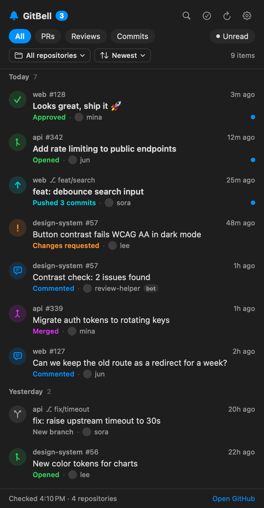

<div align="center">


# GitBell

_Your GitHub activity, one click away in the Mac menu bar or the Windows system tray._

[](https://www.npmjs.com/package/gitbell)
[](#install)
[](#windows)
[](LICENSE)

[Install](#install) · [Features](#features) · [Tips](#tips) · [FAQ](#faq) · [한국어](README.ko.md)



</div>

GitBell shows new **pull requests, reviews, comments, merges and commits** from every repository you can access, and notifies you when something happens. Nothing to set up on the repository side: no bots, no webhooks.

## Install

```bash
npx gitbell
```

GitBell builds on your Mac, installs to `~/Applications`, and starts. Click the bell in the menu bar.

> [!NOTE]
> Needs macOS 13 or later, Node.js 18+, and the Xcode command line tools (`xcode-select --install`). Because the app is built on your own Mac, macOS opens it without the "unidentified developer" warning.

### Windows

Run the same command in PowerShell or Command Prompt.

```powershell
npx gitbell
```

GitBell installs to `%LOCALAPPDATA%\Programs\GitBell`, adds a Start menu shortcut, and starts. Click the bell in the system tray next to the clock. If you don't see it, open the **^** overflow menu and drag the bell onto the taskbar.

> [!NOTE]
> Needs Windows 10 or later and Node.js 22.12+. The first install downloads Electron (about 100 MB). Your token is encrypted for your Windows account and stays on this PC; settings and history live in `%APPDATA%\GitBell`.

**Connect GitHub.** If you use [GitHub CLI](https://cli.github.com), there's nothing to do. Otherwise, paste a [personal access token](https://github.com/settings/tokens/new?scopes=repo,notifications,read:org&description=GitBell) with `repo`, `notifications` and `read:org` into the app. Fine-grained tokens can't read notifications, so GitBell then checks only repositories with recent pushes.

## Features

- **One list for everything.** PRs opened, merged or closed, approvals, change requests, comments, pushes and new branches.
- **Notifications you control.** Native banners with optional sound. Turn each type on or off, or only hear about pull requests you opened.
- **Find things fast.** Filter by type, repository, unread or **Mine** (others' activity on your PRs). Sort by newest, by repository or unread first. Search titles, people and `#numbers`.
- **Less noise.** Your own activity is hidden by default. Hide a busy repository with a right-click, or hide all bot accounts with one switch.
- **Private.** Talks only to GitHub, plus npm twice a day to check for updates. Your token stays on your computer: in the macOS Keychain, or encrypted for your Windows account.
- **English and Korean.** Follows your system language.

## Tips

| Do this | How |
| --- | --- |
| Search | <kbd>⌘</kbd> <kbd>F</kbd> (Windows: <kbd>Ctrl</kbd> <kbd>F</kbd>) |
| Refresh now | <kbd>⌘</kbd> <kbd>R</kbd> (Windows: <kbd>Ctrl</kbd> <kbd>R</kbd>) |
| Open settings | <kbd>⌘</kbd> <kbd>,</kbd> (Windows: <kbd>Ctrl</kbd> <kbd>,</kbd>) |
| Copy link, mark unread, hide a repository | Right-click an item |
| Mark a whole repository as read | Sort **By repository**, then **Mark as read** on its header |

## Update and uninstall

```bash
npx gitbell@latest                  # update (GitBell also tells you when a new version is out)
npx gitbell uninstall               # remove the app, keep settings
npx gitbell uninstall --purge       # also remove settings, history and the saved token
```

On Windows you can also remove GitBell like any other app: **Settings → Apps → Installed apps → GitBell → Uninstall**, or right-click the tray icon and choose **Uninstall GitBell…**. Tick the box in the dialog to delete your settings and saved token too.

## FAQ

<details>
<summary><b>A repository is missing.</b></summary>

GitBell checks repositories with a push in the last 3 days, plus any repository with new GitHub notifications. Quiet repositories show up as soon as something happens in them. Check that you aren't set to **Ignore** for the repository on GitHub, and that it isn't in **Settings → Hidden repositories**.

For organizations that use SAML single sign-on, authorize your token for the organization: run `gh auth refresh`, or use **Configure SSO** next to your token on GitHub.
</details>

<details>
<summary><b>I don't see notification banners.</b></summary>

Open **Settings → Notifications** in GitBell and press **Send test**. If nothing appears, open **System Settings → Notifications → GitBell**, allow notifications, and choose **Banners** or **Alerts**. Focus modes also hide banners.

On Windows, use **Settings → Notifications → Open Windows settings** and check that GitBell notifications are on. Do not disturb (Focus assist) also hides banners.
</details>

<details>
<summary><b>How do I build it from source?</b></summary>

```bash
git clone https://github.com/kgyujin/gitbell && cd gitbell
swift test && scripts/build-app.sh   # creates dist/GitBell.app
```

The Windows version is the Electron app in `windows/`.

```bash
cd windows && npm install
npm test            # unit tests
npm run test:e2e    # tests that launch the app
npm run demo        # open the panel with sample data
```
</details>
