<div align="center">

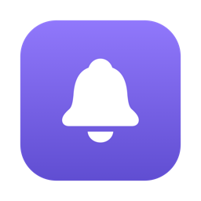

# GitBell

_Your GitHub activity, one click away in the Mac menu bar or the Windows and Linux system tray._

[](https://github.com/kgyujin/gitbell/releases/latest)
[](#macos)
[](#windows)
[](#linux)
[](LICENSE)

[Install](#install) · [Features](#features) · [Tips](#tips) · [How it checks GitHub](#how-it-checks-github) · [FAQ](#faq) · [한국어](README.ko.md)

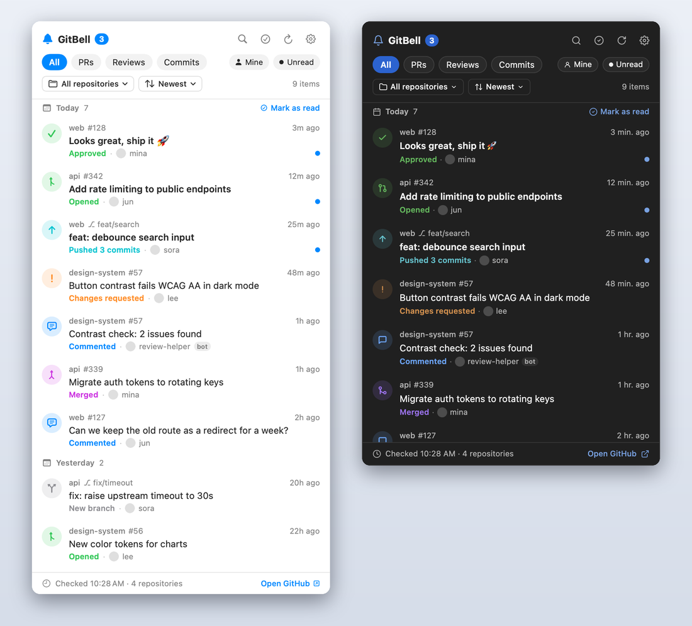

</div>

GitBell shows new **pull requests, reviews, comments, merges and commits** from every repository you can access, and notifies you when something happens. Nothing to set up on the repository side: no bots, no webhooks.

## See it in action

<table>
<tr>
<td align="center" width="50%"><b>Windows</b><br>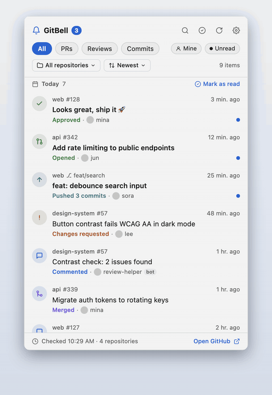</td>
<td align="center" width="50%"><b>macOS</b><br>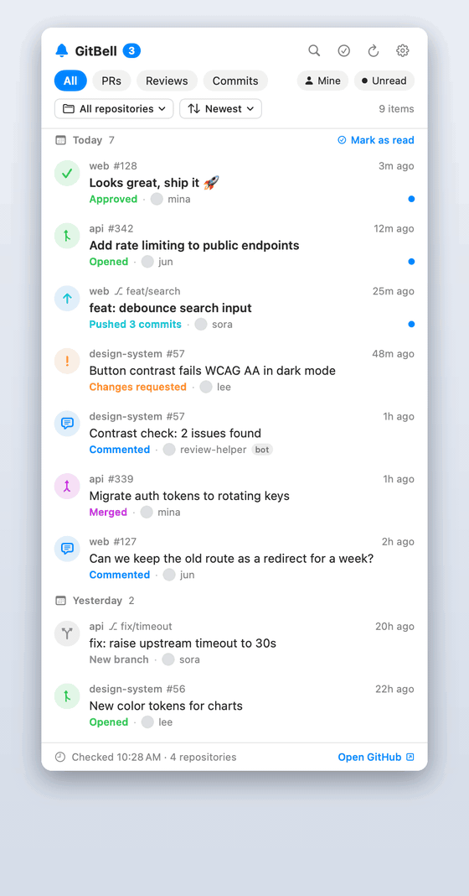</td>
</tr>
</table>

## Install

If you have Node.js, install with one command. It downloads the right installer for your system, installs it and starts GitBell, with no signing warning on first launch.

```bash
npx gitbell
```

Without Node.js, download the installer for your system from [Releases](https://github.com/kgyujin/gitbell/releases/latest) and run it.

| System | File |
| --- | --- |
| macOS 13 or later (Apple silicon and Intel) | `.dmg` |
| Windows 10 or later | `.exe` |
| Linux | `.AppImage` or `.deb` |

> [!IMPORTANT]
> The installers aren't code-signed, so when you download one in a browser your system warns you the first time you open GitBell. Allow it once as shown below and it opens normally after that.

### macOS

Open the `.dmg`, drag GitBell into **Applications**, and start it. Click the bell in the menu bar.

If macOS says it can't verify the app, go to **System Settings → Privacy & Security** and click **Open Anyway**. Or run this in Terminal:

```bash
xattr -dr com.apple.quarantine /Applications/GitBell.app
```

### Windows

Run the `.exe`; GitBell installs and starts. Click the bell in the system tray next to the clock. If you don't see it, open the **^** overflow menu and drag the bell onto the taskbar.

If "Windows protected your PC" appears, click **More info → Run anyway**.

### Linux

```bash
chmod +x GitBell-*.AppImage && ./GitBell-*.AppImage   # AppImage
sudo apt install ./GitBell-*.deb                       # Debian, Ubuntu
```

On GNOME, the tray icon needs the [AppIndicator extension](https://extensions.gnome.org/extension/615/appindicator-support/). Some desktops ignore a left click on tray icons; use **Open GitBell** from the icon's menu instead.

> [!NOTE]
> On 0.5.x? Update with `npx gitbell@latest`; it removes the old install and sets up the new app. On Windows your settings and history carry over. On macOS the old SwiftUI app stored them differently, so GitBell starts fresh and you need to paste your token again (nothing to do if you use GitHub CLI).

### Connect GitHub

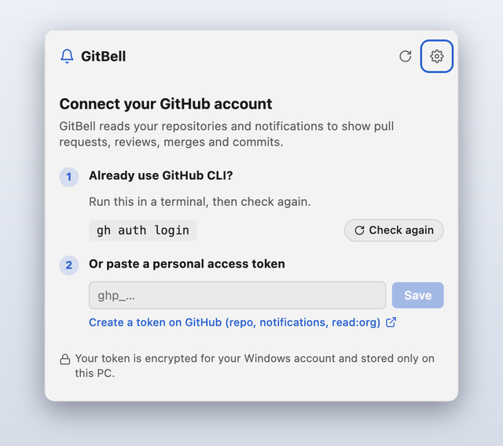

If you use [GitHub CLI](https://cli.github.com), there's nothing to do: GitBell uses your `gh` login.

Otherwise, paste a [personal access token](https://github.com/settings/tokens/new?scopes=repo,notifications,read:org&description=GitBell) with `repo`, `notifications` and `read:org` into the app.

> [!TIP]
> Fine-grained tokens can't read notifications. GitBell still works with them, but it then checks only repositories with recent pushes.

<br clear="right">

## Features

<table>
<tr>
<td width="50%" valign="top">

**One list for everything.** PRs opened, merged or closed, approvals, change requests, comments, pushes and new branches. Hover an unread item to mark it read without opening it.

</td>
<td width="50%" valign="top">

**Find things fast.** Filter by type, repository, unread or **Mine** (others' activity on your PRs), and search titles, people and `#numbers`.

</td>
</tr>
<tr>
<td>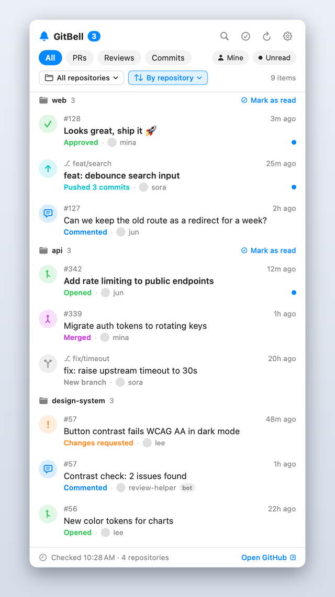</td>
<td>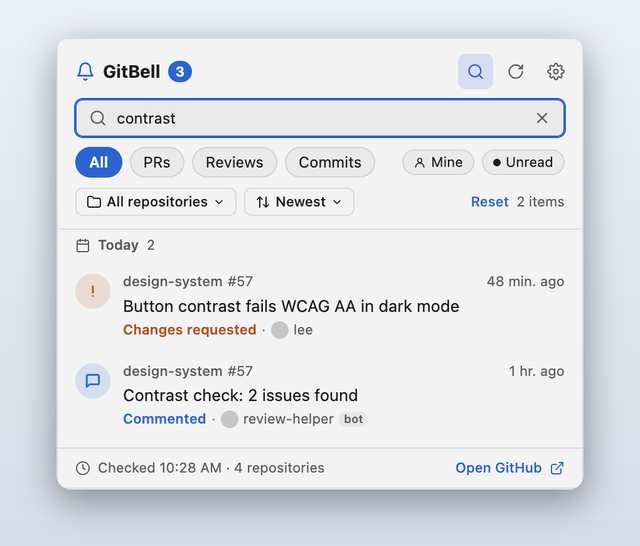</td>
</tr>
<tr>
<td width="50%" valign="top">

**Less noise.** Your own activity is hidden by default. Right-click an item to copy its link, mark it unread, show only that repository, or hide it.

</td>
<td width="50%" valign="top">

**Notifications you control.** Native banners with optional sound. Turn each type on or off, or only hear about pull requests you opened.

</td>
</tr>
<tr>
<td>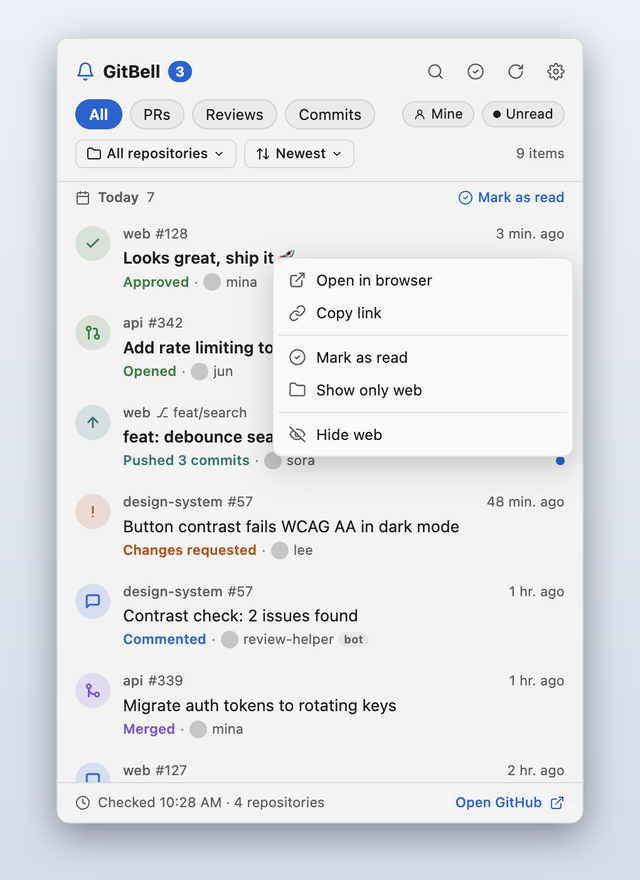</td>
<td>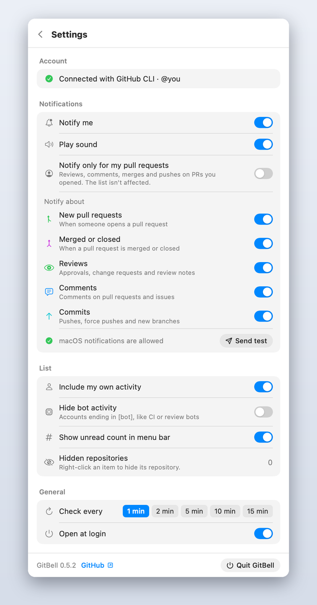</td>
</tr>
<tr>
<td width="50%" valign="top">

**Undo and updates.** Marked a whole group as read by mistake? Undo it with <kbd>⌘</kbd> <kbd>Z</kbd> / <kbd>Ctrl</kbd> <kbd>Z</kbd>. A banner tells you when a new version is out and opens the download page.

</td>
<td width="50%" valign="top">

**Sort your way.** Newest first, by repository, or unread first. Pick one repository from the menu; unread counts show next to each name.

</td>
</tr>
<tr>
<td>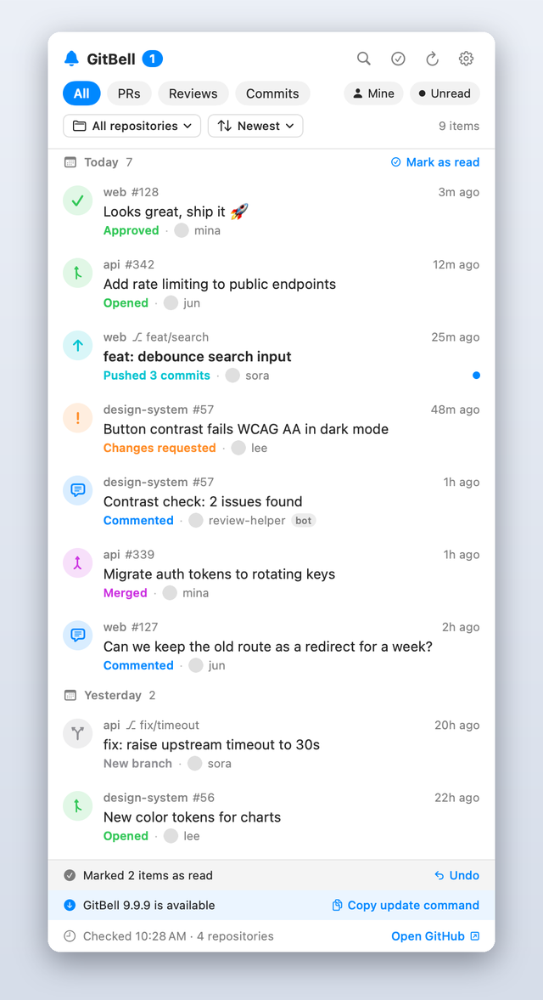</td>
<td>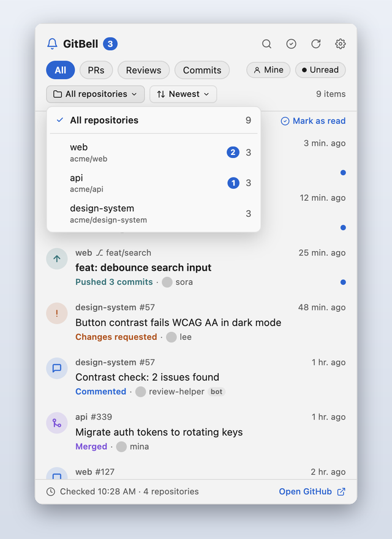</td>
</tr>
</table>

**Read state in sync with GitHub.** PRs and issues you read on GitHub turn read in GitBell, and once you've read all of a PR's or issue's activity in GitBell, its GitHub notification is marked read too. Activity with no GitHub notification, like pushes, is tracked on this computer only.

**Activity chart.** The chart button in the header shows the last 7 days of activity by day (PRs, reviews, commits) and your most active repositories.

GitBell follows your system's light or dark appearance and language (English or Korean), and works with the keyboard and screen readers (VoiceOver, Narrator).

## Tips

| Do this | How |
| --- | --- |
| Search | <kbd>⌘</kbd> <kbd>F</kbd> (Windows: <kbd>Ctrl</kbd> <kbd>F</kbd>) |
| Refresh now | <kbd>⌘</kbd> <kbd>R</kbd> (Windows: <kbd>Ctrl</kbd> <kbd>R</kbd>) |
| Open settings | <kbd>⌘</kbd> <kbd>,</kbd> (Windows: <kbd>Ctrl</kbd> <kbd>,</kbd>) |
| Undo "Mark as read" | <kbd>⌘</kbd> <kbd>Z</kbd> (Windows: <kbd>Ctrl</kbd> <kbd>Z</kbd>) |
| Copy link, mark unread, hide a repository | Right-click an item (Windows keyboard: <kbd>Shift</kbd> <kbd>F10</kbd>) |
| Mark a whole repository as read | Sort **By repository**, then **Mark as read** on its header |
| Close search, settings or the panel | <kbd>Esc</kbd> |

## How it checks GitHub

GitBell checks every few minutes (1, 2, 5, 10 or 15; default 2) and tries hard not to use up your [API rate limit](https://docs.github.com/en/rest/using-the-rest-api/rate-limits-for-the-rest-api):

- **Only what changed.** A repository is read right away when it gets a push or a notification. Quiet repositories are checked again every 15 minutes.
- **Conditional requests.** Unchanged responses come back as `304 Not Modified`, which GitHub doesn't count against your limit.
- **Batched reads.** Reviews for all changed PRs come from a single GraphQL query instead of one request per PR. GraphQL has its own limit, separate from REST.
- **Rests when offline.** With no internet connection GitBell sends nothing, and checks right away when you're back online.
- **Backs off.** When few requests are left, GitBell skips optional work; when the limit is reached, it waits until it resets.
- **Nothing lost.** If a repository can't be read for a moment, the next check picks up from where it failed.

> [!NOTE]
> GitBell talks only to GitHub (it also checks GitHub Releases once an hour for updates). Your token is encrypted with your system's protection (macOS Keychain, Windows DPAPI, the Linux secret store) and stays on this computer.

## Update and uninstall

```bash
npx gitbell@latest                  # update
npx gitbell uninstall               # remove the app, keep settings
npx gitbell uninstall --purge       # also remove settings, history and the saved token
```

When a new version is out, a banner appears at the top of the panel, plus a notification if notifications are on. Click it to open the download page; installing the new version keeps your settings and history.

Without Node.js, uninstall your system's usual way. Settings and history are kept; delete the folder below to remove them too.

| System | Uninstall | Settings, history, saved token |
| --- | --- | --- |
| macOS | Move GitBell from Applications to the Trash | `~/Library/Application Support/GitBell` |
| Windows | **Settings → Apps → Installed apps → GitBell → Uninstall** | `%APPDATA%\GitBell` |
| Linux | Delete the AppImage, or `sudo apt remove gitbell` | `~/.config/GitBell` |

## FAQ

<details>
<summary><b>A repository is missing.</b></summary>

GitBell checks repositories with a push in the last 3 days, plus any repository with new GitHub notifications. Quiet repositories show up as soon as something happens in them. Check that you aren't set to **Ignore** for the repository on GitHub, and that it isn't in **Settings → Hidden repositories**.

For organizations that use SAML single sign-on, authorize your token for the organization: run `gh auth refresh`, or use **Configure SSO** next to your token on GitHub.
</details>

<details>
<summary><b>I don't see notification banners.</b></summary>

Open **Settings → Notifications** in GitBell and press **Send test**. If nothing appears, open **System Settings → Notifications → GitBell**, allow notifications, and choose **Banners** or **Alerts**. Focus modes also hide banners.

On Windows, use **Settings → Notifications → Open system settings** and check that GitBell notifications are on. Do not disturb (Focus assist) also hides banners.
</details>

<details>
<summary><b>Something shows up a few minutes late.</b></summary>

Pushes and anything that reaches your GitHub notifications appear on the next check. Activity in repositories you don't watch (for example a comment in an organization repository) can take up to 15 minutes, because quiet repositories are checked less often to save your API limit. Press <kbd>⌘</kbd> <kbd>R</kbd> / <kbd>Ctrl</kbd> <kbd>R</kbd> to check now.
</details>

<details>
<summary><b>How do I build it from source?</b></summary>

Every system runs the same Electron app. You need Node.js 22 or later.

```bash
git clone https://github.com/kgyujin/gitbell && cd gitbell
npm install
npm start           # run it
npm run demo        # open the panel with sample data
npm test            # unit tests
npm run test:e2e    # tests that launch the app
npm run dist        # build this system's installer into dist/
```
</details>
